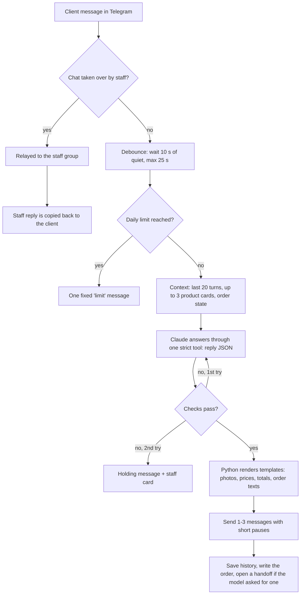

# Telegram AI Sales Assistant

[](https://github.com/Folse27/telegram-ai-sales-bot/actions/workflows/ci.yml)


A Telegram bot that sells like a well-trained shop assistant. It answers product questions from a catalog,
sends photos, quotes exact prices, takes orders up to payment, and hands the conversation to a person when it
should. The assistant («Микола») writes in Ukrainian and uses Claude (Anthropic) for the conversation, but
**every price, total, contact and payment detail comes from code, not from the model**.

It was built as a working demo on the public catalog of a real electronics manufacturer (95 products). This
repository ships a **fictional sample shop** («Обрій Тех», 10 products, placeholder images and contacts) so
it runs without any private data.

## Contents

- [What it does](#what-it-does)
- [How it works](#how-it-works)
- [Design decisions and trade-offs](#design-decisions-and-trade-offs)
- [Run it](#run-it)
- [Configuration](#configuration)
- [Tests and CI](#tests-and-ci)
- [Security notes](#security-notes)
- [Costs](#costs)

## What it does

- **Answers from the catalog.** Prices with and without VAT, options, colours, warranty, delivery. It says
  plainly when a product doesn't exist instead of inventing one.
- **Waits until the client stops typing.** Four short messages in a row get one coherent reply.
- **Shows products.** Photo cards and albums, colour photos, exact price quotes for several items.
- **Takes orders.** It collects name, phone, city, delivery branch and buyer type, then sends a summary to
  confirm. A private buyer then gets the payment details exactly once; company orders and VAT-free requests
  go to staff.
- **Hands over to people.** A card with buttons appears in a staff group (✋ take · 🤖 back to bot · ✅ close).
  Staff reply through the bot, and the chat returns to the bot by button or after 12 h of silence.
- **Reports itself.** `/stats` in the staff group shows replies, rejected drafts, AI cost, cache share,
  latency (median and 90th percentile) and orders. `/orders`, `/paid N` and `/cancel N` manage orders.
- **Protects the budget.** Per-client daily reply cap and a daily AI budget for the whole bot.

## How it works



| Module | Responsibility |
|---|---|
| `salesbot/sessions.py` | Per-chat debounce state machine: collect, generate, send. A message during generation cancels and merges; one during sending queues the next reply. |
| `salesbot/pipeline.py` | Builds the prompt context, calls the model, runs the checks with one retry, assembles the reply, writes results after delivery. |
| `salesbot/llm.py` | Request shape per model family (forced tool use, thinking, effort), prompt caching, cost estimate. |
| `salesbot/validation.py` | Checks on the model's own text: Ukrainian only, no invented numbers, VAT wording, no payment details, honest identity. |
| `salesbot/templates.py` | Every client-facing text Python renders: product cards, quotes, order messages. |
| `salesbot/orders.py` | Pure order state machine: `DRAFT → AWAITING_CONFIRMATION → PAYMENT_SENT / MANAGER_REVIEW → PAID / CANCELLED`. |
| `salesbot/handoff.py` | Staff group: cards, buttons, two-way relay, commands, `/stats`. |
| `salesbot/photos.py` | Lazy Telegram photo cache. |
| `salesbot/shop.py` | Shop data (catalog, texts, prompt examples) from a folder or the database. |
| `salesbot/tools.py` | Operator CLI: config check, shop upload, photo warm-up, webhook. |

## Design decisions and trade-offs

**The model chooses, the code fills in.** The model never writes a total, a payment detail or a contact.
It returns structured JSON through one strict tool (`reply`), and names templates and items. Python computes
every amount from the catalog and renders the text. A wrong sum or a hallucinated bank account can't reach a
client.

**Check, retry once, then hand over.** Free text is checked for invented numbers (every number must appear in
the catalog cards, the conversation or the order), Russian words, a VAT-free price without its legal condition,
and claims to be human. A rejected draft goes back to the model with the reasons, once. If it fails again, the
client gets a holding message and staff get a card. Correctness wins over always answering.

**Debounce instead of instant replies.** People send thoughts in bursts. Waiting for 10 s of quiet (max 25 s)
costs a little latency and saves duplicate, contradicting answers and AI calls. A first reply typically arrives
about 13–16 s after the client's last message.

**Prompt caching.** About 15k tokens of rules, examples and the catalog index stay identical for every chat and
are cached for 1 hour. Every reply then pays about a tenth of the price for them. Anything that changes per chat
goes after the cached part.

**Lazy photo cache.** Telegram can resend a file the bot already uploaded by its `file_id`, instantly and for
free, but each bot has to upload every image once. Photos are uploaded the first time they are needed, and the
id is stored. A warm-up command does this in advance. A stored id that stops working (e.g. after a bot token
change) is dropped and the photo uploaded again.

**Shop data is separate from the engine.** The catalog, texts and prompt examples of a shop are data: a
folder for development, or rows in the database for production (`shop upload`). A private catalog never has
to be committed, and a new shop needs no code change.

**One process, no queue, no timers.** A single aiohttp process serves the webhook. The "back to the bot after
12 h" rule is checked on the next message instead of by a scheduler, and the database pool keeps no idle
connections, so a free serverless Postgres can sleep. The cost is that a restart loses messages still being
debounced. The bot answers anything unanswered from the last 2 minutes on startup, which covers deploys.

**Ukrainian only, on purpose.** The shop sells in Ukraine. The bot answers Russian-speaking clients in Ukrainian,
and a check enforces it.

## Run it

Requirements: Python 3.14, a Telegram bot token, an Anthropic API key, a Postgres database and a Telegram group
for staff, with the bot as an admin.

```bat
python -m venv .venv
.venv\Scripts\activate
pip install -r requirements-dev.txt
copy .env.example .env
```

Fill in `.env` (see [Configuration](#configuration)), then:

| Command | What it does |
|---|---|
| `python -m salesbot --polling` | Run locally without a public URL (long polling) |
| `python -m salesbot` | Run the webhook server (production) |
| `python -m salesbot.tools check-config` | Validate the environment and the shop data |
| `python -m salesbot.tools shop upload <folder>` | Store a shop folder in the database (`SHOP_SOURCE=db`) |
| `python -m salesbot.tools photos warm --chat <id>` | Upload all uncached photos once (e.g. into a private channel) |
| `python -m salesbot.tools webhook info` | Show Telegram's webhook status (secret masked) |

**Deploy (Render):** `render.yaml` is a Blueprint for a free web service. Its build runs `check-config`,
so a missing variable or missing shop data fails the build while the previous version keeps running. Point
an uptime monitor at `/healthz` to keep the free instance awake.

**Telegram commands:** clients use `/start`, and testers can also use `/clear`. Staff use `/orders`,
`/paid N`, `/cancel N`, `/bot <chat id>` and `/stats [hours]`.

## Configuration

All settings are environment variables; `.env.example` lists every one with a comment. The required ones are
checked at startup, and the bot refuses to start with a message that names each missing variable.

| Variable | Meaning |
|---|---|
| `TELEGRAM_BOT_TOKEN`, `WEBHOOK_SECRET` | Bot token; a random secret for the webhook path and header (required) |
| `ADMIN_CHAT_ID` | Staff group id (required) |
| `ANTHROPIC_API_KEY`, `MODEL` | API key (required); `claude-haiku-4-5` or `claude-sonnet-5-5` |
| `DATABASE_URL` | Postgres URL (required) |
| `SHOP_SOURCE` | `data/sample` (default), another folder, or `db` |
| `DAILY_REPLIES_PER_USER`, `DAILY_BUDGET_USD` | Usage limits; `0` turns a limit off |
| `CACHE_TTL`, `MAX_PARTS`, `DEBOUNCE_*`, `PART_GAP_*` | Prompt cache lifetime, messages per reply, timing |
| `LOG_FORMAT` | `text` (default) or `json`: one object per line with fields such as `event`, `chat_id`, `latency_ms` |

## Tests and CI

```bat
python -m pytest -q          :: unit tests; database tests too when TEST_DATABASE_URL is set
ruff check salesbot tests
mypy
```

- **61 tests:**
  - 51 need nothing: the debounce engine on a virtual clock, catalog maths, retrieval, the reply checks, the
    order state machine, the request shape per model, and the log format.
  - 10 run against a real Postgres, each in its own throwaway schema: handoff, relay, commands, `/stats`,
    photo cache, shop data, usage limits.
- **CI:** GitHub Actions runs lint, the type check and all tests against a Postgres service on every push.
  Dependabot opens weekly update pull requests for the Python packages and the CI actions.
- **Live harness:** `tests/test_live.py` plays 19 scripted conversations against the real model, including a
  prompt-injection discount attempt, a VAT trap, a burst of messages, a full order and a staff takeover. It
  costs money, so it only runs with `RUN_LIVE=1` and stops at a budget (`LIVE_BUDGET`, default $4). On the
  original 95-product catalog all 19 conversations passed 3 of 3 runs.

## Security notes

- **Secrets** live only in environment variables; `.env*` files are git-ignored except the template.
- **Webhook:** the path contains a secret, Telegram's secret header is checked on every update, and the access
  log masks the path.
- **Client text** is wrapped as untrusted data, so instructions inside a message don't change the rules or any
  price. It can't close the wrapper either.
- **SQL** values always go in as query parameters.
- **Payment details** go out only through the order flow, at most once per order. A draft that contains them
  anyway is dropped and escalated.
- **Duplicate updates** from Telegram retries are ignored.
- **Usage limits** cap what a single client, or the whole bot, can spend per day.
- **Logs** contain ids, counts, timings and statuses, never the text of client messages.

## Costs

| Item | Cost |
|---|---|
| AI, Claude Haiku 4.5 | about $0.01 per reply |
| AI, Claude Sonnet 5.5 | about $0.02 per reply (78 measured replies: $1.54) |
| Hosting, database, uptime monitor | free plans |

`/stats` shows the live numbers.

## License

[MIT](LICENSE). The sample shop is fictional; any resemblance of its names to real products is coincidental.
